<p align="center">
  <a href="https://axsomette.github.io/lucas-jimenez-boulot/"></a>
</p>

<p align="center">
  <a href="https://axsomette.github.io/lucas-jimenez-boulot/"></a>
  &nbsp;
  <a href="https://axsomette.github.io/lucas-jimenez-boulot/blog/"></a>
  &nbsp;
  <a href="https://axsomette.github.io/lucas-jimenez-boulot/#contact"></a>
</p>

Le portfolio de **Lucas Jimenez Boulot**, développeur full-stack basé à Montpellier. Je conçois des
applications web complètes, de la base de données jusqu'à l'interface : Drupal et PHP pour des clients
d'agence, React, Next.js et Astro pour le reste.

Ce dépôt contient le site lui-même, sa charte graphique et ses articles.

## Ce qu'on y trouve

<p align="center">
  
  
  
  
</p>

- **Projets** : dix fiches (huit pro, deux perso), filtrables, avec la stack, le statut et le lien
  quand le site est en ligne.
- **Parcours** : les postes occupés depuis 2022, calculés à partir des fiches d'expérience.
- **Développement assisté par IA** : `drupal-expert`, une chaîne de sous-agents qui n'écrit dans un projet
  qu'après sauvegarde, revue de code et validation de la configuration.
- **Blog** : treize retours d'expérience sur Drupal, PHP et JavaScript, avec un [flux RSS](https://axsomette.github.io/lucas-jimenez-boulot/rss.xml).
- **Contact** : un formulaire (Formspree, protégé par Cloudflare Turnstile et un champ piège).

## En images

<p align="center">
  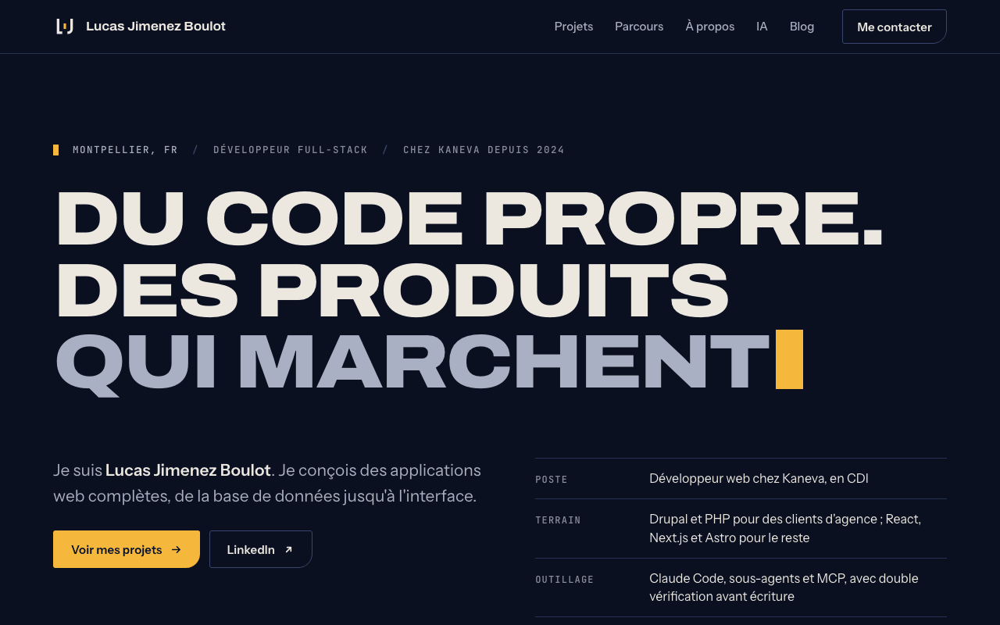
</p>

<p align="center">
  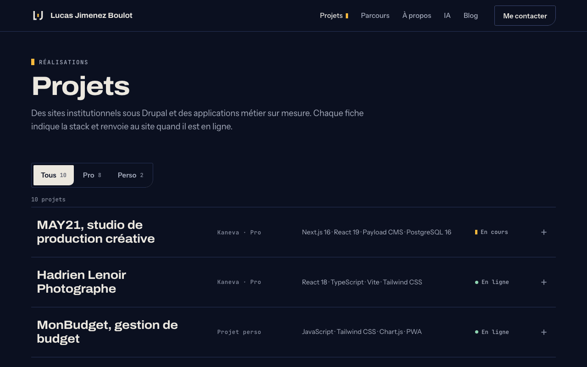
  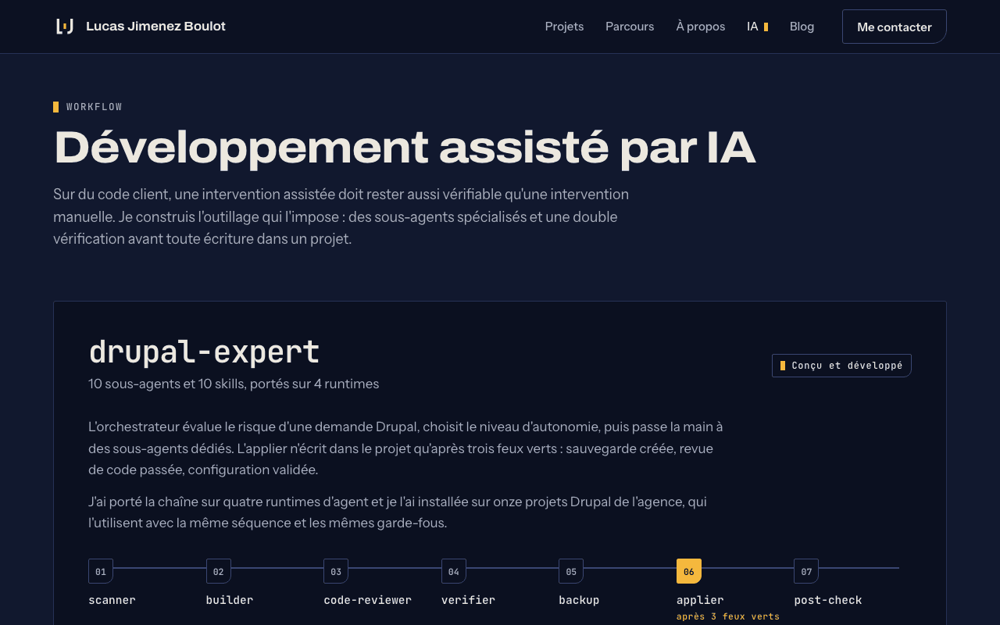
</p>

<p align="center">
  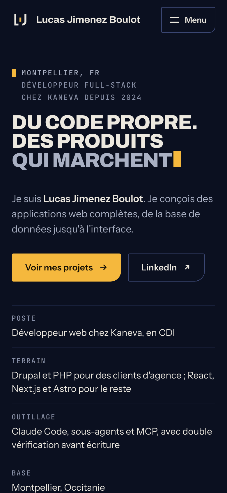
  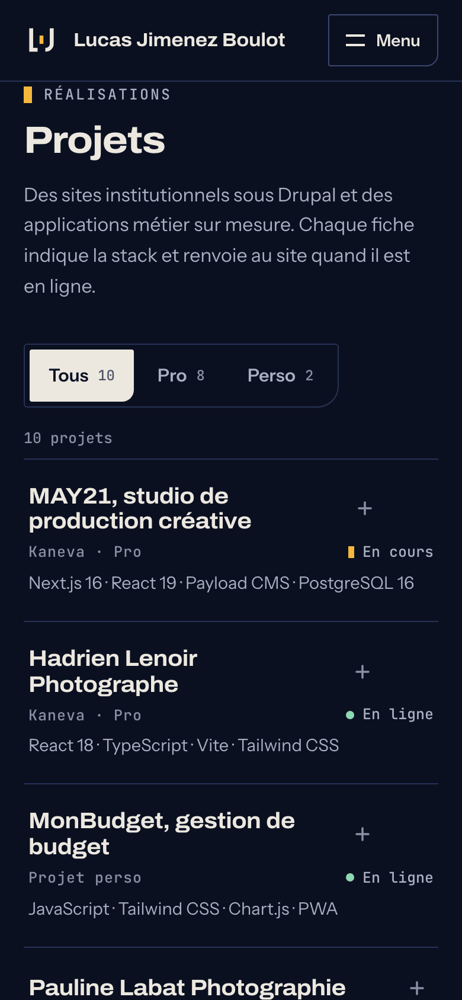
  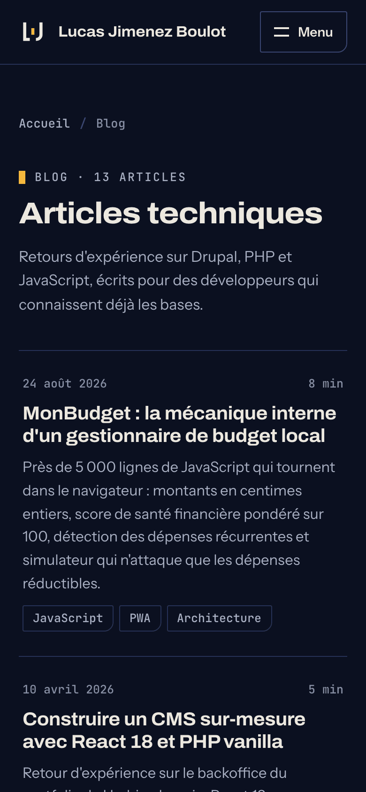
</p>

## Sous le capot

<p>
  
  
  
  
  
</p>

- **Astro**, en sortie 100 % statique : aucune page ne charge de JavaScript dont elle n'a pas besoin.
- **TypeScript** strict et **Content Collections** : projets, expériences et articles sont des fichiers
  Markdown ou MDX validés au build.
- **CSS natif**, sans framework : variables (les couleurs de la charte), cascade layers et container queries.
- **Animations en CSS** : le logo qui se dessine au premier chargement, les révélations au défilement là
  où le navigateur les gère nativement. Tout s'arrête si le système demande de réduire les animations.
- **Sitemap** et **flux RSS** générés au build.

Le site vit dans [`MonPortfolio/`](MonPortfolio/). Les choix techniques sont détaillés dans
[`MonPortfolio/ARCHITECTURE.md`](MonPortfolio/ARCHITECTURE.md).

## Lancer le site en local

Node.js 22.23.4 (version exacte dans `MonPortfolio/.nvmrc`).

```bash
cd MonPortfolio
npm ci
npm run dev
```

Le site s'ouvre sur http://localhost:4321/lucas-jimenez-boulot/.

| Commande | Rôle |
|---|---|
| `npm run dev` | Serveur de développement |
| `npm run build` | Construit le site dans `MonPortfolio/dist/` |
| `npm run preview` | Sert le build en local |
| `npm run lint` | Vérifie les types (`tsc --noEmit`) |
| `npm run format` | Formate `src/` avec Prettier |

Le formulaire de contact passe par Formspree et Cloudflare Turnstile. Pour utiliser d'autres identifiants
(`PUBLIC_FORMSPREE_ID`, `PUBLIC_TURNSTILE_SITE_KEY`), voir [`MonPortfolio/SETUP_CONTACT.md`](MonPortfolio/SETUP_CONTACT.md).

**Déploiement** : chaque push sur `main` lance [`.github/workflows/deploy.yml`](.github/workflows/deploy.yml),
qui construit le site et le publie sur GitHub Pages.

## La charte

<p>
  
  
  
  
</p>

Le L et le J se font face pour former un socle : un angle droit côté back, une courbe côté front. Le
curseur au milieu, c'est le travail en cours ; c'est aussi le seul élément en Signal. Titres en Archivo,
texte en Instrument Sans, données en JetBrains Mono, et des coins en `3px 3px 18px 3px`, comme le logo.

Tout est dans [`MonPortfolio/brand/GUIDE.md`](MonPortfolio/brand/GUIDE.md), avec les fichiers du logo.

## Licence

Ce projet est sous licence MIT, voir [`LICENSE`](LICENSE).
